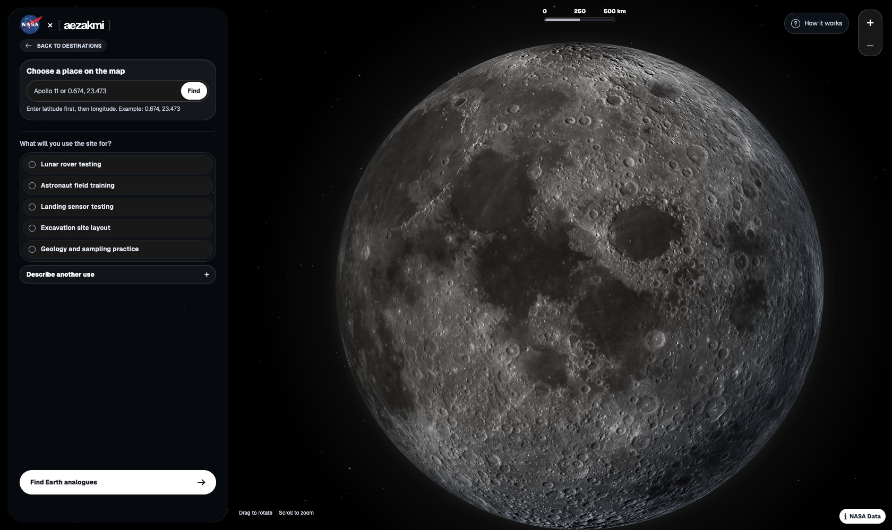
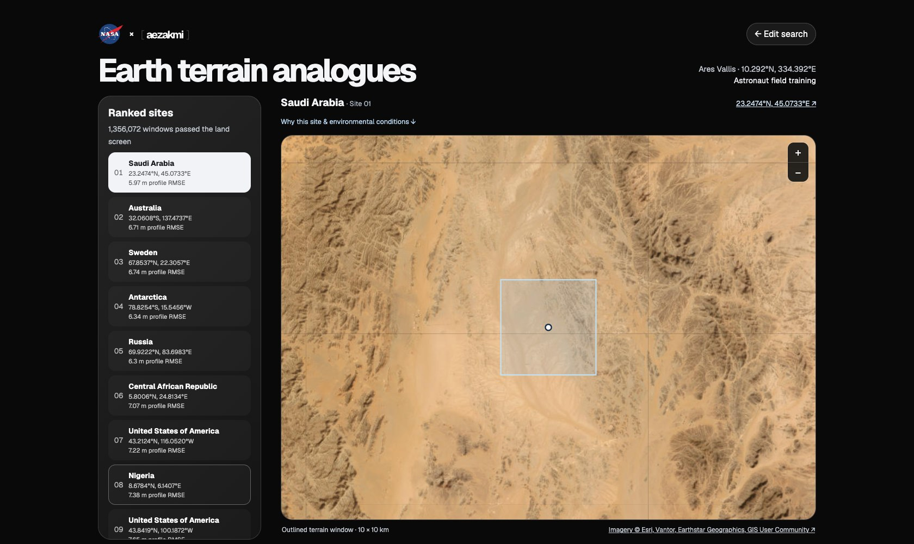

# Earth analogues for Moon and Mars

Pick a place on the Moon or Mars. Find places on Earth where a team could prepare a field test.

**[Try the explorer](https://nasa.aezakmi.org) · [Project presentation (PDF)](presentation.pdf) · [How we compare terrain](https://github.com/naza-aezakmi/ml/blob/main/docs/MODEL_CARD.md) · [Data sources](https://github.com/naza-aezakmi/ml/blob/main/docs/DATA_SOURCES.md)**

## What we built

A 3D map that connects a mission destination to Earth terrain. Choose a point, select what you want to test, and get ten ranked candidates with countries, coordinates and satellite imagery.

The search compares terrain shape, elevation range, regional slope and roughness across **1,356,072 eligible Earth windows**. Each window is about **10 × 10 km**. Rover testing, astronaut training, landing sensors, excavation layout and geology practice use different priorities.

Each result explains which criteria helped the match and where differences remain. Temperature, wind, pressure and other available conditions appear separately, with their sources and time periods.

## Inside the project

| Repository | What it contains |
|---|---|
| [web](https://github.com/naza-aezakmi/web) | The globe, search form, satellite view and explanations. Nuxt, Vue, TypeScript and Three.js. |
| [api](https://github.com/naza-aezakmi/api) | The terrain atlas, search, country labels and environmental data. FastAPI, Python and a Node.js worker. |
| [ml](https://github.com/naza-aezakmi/ml) | Data analysis, matching method, SHAP explanations and the separate trained KMeans experiment. |

We use NASA LOLA for the Moon, NASA MOLA for Mars and NOAA ETOPO for Earth. The aim is to help teams shortlist field locations; a regional terrain match still needs detailed maps and on-site assessment.

Built by **Aezakmi** for the NASA Space Apps challenge *Identify Earth Locations that Analog the Permanent Moon Base Locations and Mars*.

Planet imagery: NASA Trek. Earth imagery: Esri and its contributors, credited in the app. This is an independent team project.
